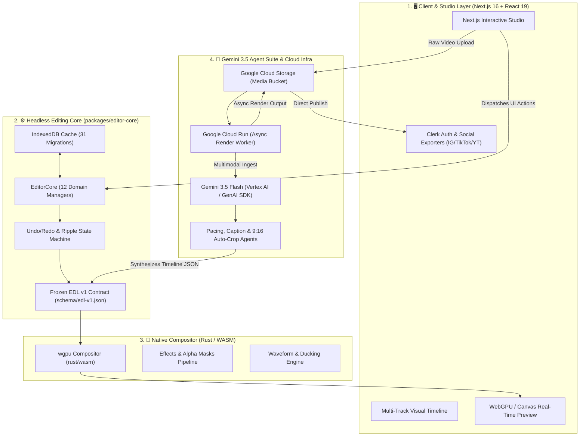

<div align="center">

# 🎬 FinalCliper AI
### Autonomous Multi-Track Video Editor
**Powered by Gemini 3.5 Flash &amp; Google Cloud**

[](https://allthingsagentichackathon.devpost.com)
[](https://allthingsagentichackathon.devpost.com)
[](https://deepmind.google/technologies/gemini/)
[](https://cloud.google.com/)
[](LICENSE)

<br />

<p align="center">
  <b>FinalCliper AI</b> is an autonomous, background agentic video editor that transforms raw multi-hour footage into polished, multi-track, social-ready videos. Built with a decoupled headless editing engine, native Rust/WASM compositor, and Gemini 3.5 Flash reasoning loops on Google Cloud.
</p>

</div>

---

## 📑 Table of Contents

- [Overview](#-overview)
- [Key Features](#-key-features)
- [System Architecture](#-system-architecture)
- [How It Works (Data Flow)](#-how-it-works-data-flow)
- [Repository Structure](#-repository-structure)
- [Step-by-Step Setup &amp; Spin-Up Guide](#-step-by-step-setup--spin-up-guide)
  - [1. Prerequisites](#1-prerequisites)
  - [2. Clone &amp; Install](#2-clone--install)
  - [3. Configure Environment Variables](#3-configure-environment-variables)
  - [4. Run the Development Server](#4-run-the-development-server)
  - [5. Building the Web App](#5-building-the-web-app)
  - [6. Running Tests &amp; CI Verification Gates](#6-running-tests--ci-verification-gates)
  - [7. (Optional) Local Rust / WASM Compilation](#7-optional-local-rust--wasm-compilation)
- [Technical Deep Dives](#-technical-deep-dives)
  - [Headless Engine Core (`packages/editor-core`)](#headless-engine-core-packageseditor-core)
  - [The Frozen EDL v1 Contract](#the-frozen-edl-v1-contract)
  - [Rust / WASM Compositor Engine](#rust--wasm-compositor-engine)
- [Google Cloud &amp; AI Integration](#-google-cloud--ai-integration)
- [Troubleshooting &amp; Common Questions](#-troubleshooting--common-questions)
- [License &amp; Attribution](#-license--attribution)

---

## 🌟 Overview

Video editing is traditionally a high-friction, manual process: creators spend hours scrubbing through raw footage, trimming silence, timing text captions, balancing background music, and manually cropping frames for vertical formats ($9:16$).

Most AI tools act merely as prompt chatbots. **FinalCliper AI** is built on an **agentic foundation**—operating asynchronously in the background as an autonomous editor that:
1. Ingests raw video/audio streams into Google Cloud Storage.
2. Uses **Gemini 3.5 Flash** for multimodal scene boundary parsing, narrative hook detection, and transcript alignment.
3. Compiles creative decisions into a deterministic **Edit Decision List (EDL v1 JSON)**.
4. Executes multi-track trimming, ripple placement, kinetic caption overlays, and audio ducking on **Google Cloud Run** and the local headless engine.

---

## ⚡ Key Features

- 🧠 **Autonomous Multimodal Reasoning:** Evaluates hours of raw footage in seconds using Gemini 3.5 Flash to pinpoint key talking points, hooks, and topic transitions.
- ✂️ **Intelligent Ripple &amp; Retime Engine:** Automatic dead-air elimination, smart trim/split, and dynamic pacing adjustment without desynchronizing audio.
- 💬 **Context-Aware Kinetic Subtitles:** Word-level timestamp synchronization with customizable animated typography and high-impact keyword emphasis.
- 📱 **Subject-Aware 9:16 Auto-Cropping:** Computer-vision focal tracking to adapt landscape footage ($16:9$) into vertical shorts (TikTok, Reels, Shorts).
- 🎵 **Smart Audio Ducking:** Real-time audio waveform balancing that automatically ducks background music beneath spoken voice tracks.
- ☁️ **Asynchronous Cloud Run Pipeline:** Offloads heavy export rendering to serverless Google Cloud Run workers, keeping client resources free.
- 🔒 **Local-First &amp; Deterministic:** Headless core operates with zero cloud coupling required for editing playback, with strict offline verification gates.

---

## 🏛️ System Architecture

FinalCliper AI is architected across four decoupled layers:



---

## 🔄 How It Works (Data Flow)

1. **Ingestion:** User uploads raw video feeds via the Next.js Studio $\rightarrow$ streamed to **Google Cloud Storage (GCS)**.
2. **Multimodal Analysis:** **Gemini 3.5 Flash** (via `@google/genai`) ingests keyframes and audio waveforms in parallel.
3. **Agent Decision Loop:**
   - *Pacing Agent:* Detects viral hooks and trims silent dead zones.
   - *Caption Agent:* Generates kinetic subtitle tokens with word-level timecodes.
   - *Framing Agent:* Identifies primary speakers for dynamic $9:16$ vertical framing.
4. **EDL Synthesis:** Decisions are compiled into the standardized `schema/edl-v1.json` contract.
5. **Execution &amp; Render:** 
   - Local playback is synced immediately through `packages/editor-core` and Rust WASM.
   - Final production rendering is offloaded asynchronously to **Google Cloud Run**.

---

## 📂 Repository Structure

```text
finalcliper/
├── apps/
│   ├── web/                     # Next.js 16 interactive studio UI
│   │   ├── src/                 # Studio UI components, timeline inspector, social hooks
│   │   ├── .env.local           # Local secrets & API keys (gitignored)
│   │   └── package.json         # Web dependencies (@google/genai, @clerk/nextjs, etc.)
│   └── desktop/                 # Inherited native GPUI desktop shell
├── packages/
│   ├── editor-core/             # Headless editing engine (TypeScript, zero UI framework imports)
│   │   ├── src/                 # 12 Domain Managers, Command Stack, Migrations
│   │   └── schema/              # Frozen EDL v1 bridge contract (edl-v1.json)
│   └── mobile-ui/               # Shared mobile UI components
├── rust/                        # High-performance native compositor
│   ├── crates/                  # {gpu, compositor, effects, masks, time}
│   └── wasm/                    # Rust WebAssembly bridge (wgpu)
├── docs/                        # Architecture decisions (DECISIONS.md, EDL.md, RELEASING.md)
├── scripts/                     # Invariant gates (offline-audit.sh, check-headless.mjs)
├── architecture-diagram.svg     # Visual system architecture diagram
├── devpost-thumbnail-v2.svg     # Official hackathon hero thumbnail
├── logo.svg                     # FinalCliper AI project icon
├── package.json                 # Monorepo configuration (Bun workspaces + Turborepo)
└── turbo.json                   # Turborepo task pipeline configuration
```

---

## 🚀 Step-by-Step Setup &amp; Spin-Up Guide

Follow these exact steps to spin up and test the project locally:

### 1. Prerequisites

Make sure you have the following installed on your machine:
- **[Bun](https://bun.sh)** `1.2.18+` *(Required monorepo package manager — this repo uses Bun workspaces)*
- **Node.js** `v20.x` or `v22.x`
- **Git**

```bash
# Verify installations
bun --version
node --version
git --version
```

---

### 2. Clone &amp; Install

```bash
# 1. Clone the repository
git clone https://github.com/GurukantPatil01/finalcliper.git
cd finalcliper

# 2. Install dependencies across all workspaces
bun install
```

---

### 3. Configure Environment Variables

Create the local environment file `apps/web/.env.local`:

```bash
cp apps/web/.env.example apps/web/.env.local 2>/dev/null || touch apps/web/.env.local
```

Populate `apps/web/.env.local` with your configuration:

```env
# Runtime Environment
NODE_ENV=development
NEXT_PUBLIC_SITE_URL=http://localhost:3000
NEXT_PUBLIC_AI_ENABLED=true

# Google Gemini API Key (Required for Gemini 3.5 Flash Agentic features)
GEMINI_API_KEY=your_gemini_api_key_here

# (Optional) Authentication with Clerk
NEXT_PUBLIC_CLERK_PUBLISHABLE_KEY=pk_test_...
CLERK_SECRET_KEY=sk_test_...
NEXT_PUBLIC_CLERK_SIGN_IN_URL=/sign-in
NEXT_PUBLIC_CLERK_SIGN_UP_URL=/sign-up

# (Optional) Social Publishing APIs
INSTAGRAM_ACCESS_TOKEN=your_instagram_access_token
INSTAGRAM_ACCOUNT_ID=your_instagram_account_id
```

> 💡 **Tip:** You can obtain a free Gemini API key from [Google AI Studio](https://aistudio.google.com/).

---

### 4. Run the Development Server

Start the Next.js 16 Web Studio with Turborepo:

```bash
# From repo root:
bun run dev:web
```

Or run directly inside `apps/web`:

```bash
cd apps/web
bun run dev
```

Open your browser and navigate to:
```text
http://localhost:3000
```

---

### 5. Building the Web App

To compile a production build of the web application:

```bash
bun run build:web
```

To preview the built production bundle locally:

```bash
bun run preview:web
```

---

### 6. Running Tests &amp; CI Verification Gates

FinalCliper includes automated invariant gates to guarantee code quality and offline/headless integrity:

```bash
# 1. Run unit and integration tests across packages
bun test

# 2. Run the complete merge-gate invariants check (build + typecheck + lint + tests)
bash scripts/invariants.sh

# 3. Verify the offline / zero-network-leak guarantee
bash scripts/offline-audit.sh
```

---

### 7. (Optional) Local Rust / WASM Compilation

*Note: A pre-compiled WASM package is bundled by default. You only need this step if you are modifying native Rust crates under `rust/`.*

```bash
# Install Rust toolchain & wasm-pack (once)
curl --proto '=https' --tlsv1.2 -sSf https://sh.rustup.rs | sh
cargo install wasm-pack cargo-watch

# Build the WASM package
bun run build:wasm

# Link local WASM package into apps/web
cd rust/wasm/pkg && bun link
cd ../../../apps/web && bun link opencut-wasm

# Start watch mode for automatic Rust recompilation
bun run dev:wasm
```

---

## 🔬 Technical Deep Dives

### Headless Engine Core (`packages/editor-core`)

The core editing engine is completely decoupled from UI frameworks (no React, no Next.js, no DOM assumptions). It is strictly type-checked and enforced via `scripts/check-headless.mjs`.

It contains **12 specialized domain managers**:
- **`TimelineManager`:** Multi-track composition, track ordering, and z-index layer indexing.
- **`PlacementManager`:** Clip collisions, snap-to-grid, and magnetic ripple placement.
- **`RetimeManager`:** Variable speed ramping, reverse playback, and audio pitch correction.
- **`AudioManager`:** Audio volume envelopes, ducking curve calculation, and pan controls.
- **`StorageManager`:** IndexedDB transactions with 31 progressive version migrations.
- **`CommandManager`:** Infinite undo/redo command stack with memory reclamation.

---

### The Frozen EDL v1 Contract

Located at `packages/editor-core/schema/edl-v1.json`, the **EDL (Edit Decision List)** acts as the universal bridge between Gemini 3.5 reasoning outputs and media compositing engines:

```json
{
  "version": "1.0",
  "timeline": {
    "fps": 30,
    "resolution": { "width": 1080, "height": 1920 },
    "tracks": [
      {
        "id": "v1",
        "type": "video",
        "clips": [
          {
            "id": "clip-01",
            "source": "gs://finalcliper-bucket/raw.mp4",
            "start": 0.0,
            "duration": 4.5,
            "crop": { "x": 0.2, "y": 0.0, "width": 0.5625, "height": 1.0 }
          }
        ]
      },
      {
        "id": "t1",
        "type": "caption",
        "clips": [
          {
            "id": "cap-01",
            "text": "Autonomous Agentic Video Editing",
            "start": 0.5,
            "duration": 3.0,
            "style": { "animation": "kinetic-pop", "color": "#38bdf8" }
          }
        ]
      }
    ]
  }
}
```

---

### Rust / WASM Compositor Engine

The rendering engine in `rust/` compiles to WebAssembly via `wasm-pack`:
- **wgpu Compute Pipelines:** Hardware-accelerated blend modes, chroma keying, and color grading.
- **Frame-Accurate Seek:** Sub-millisecond scrubbing latency without UI thread blocking.

---

## ☁️ Google Cloud &amp; AI Integration

| Service / SDK | Role in FinalCliper AI |
| :--- | :--- |
| **Gemini 3.5 Flash** | Multimodal reasoning for scene cuts, transcripts, &amp; 9:16 auto-framing |
| **Google GenAI SDK (`@google/genai`)** | High-throughput structured prompt orchestration and JSON schema enforcement |
| **Google Cloud Run** | Serverless, containerized background rendering worker |
| **Google Cloud Storage (GCS)** | High-speed ingestion bucket for raw media and finalized video delivery |
| **Vertex AI** | Low-latency inference endpoints and context caching |
| **Cloud Logging** | OpenTelemetry-compliant audit logs for agent reasoning traces |

---

## ❓ Troubleshooting &amp; Common Questions

<details>
<summary><b>Q: Getting error with <code>bun run dev:web</code>?</b></summary>

Make sure you ran `bun install` at the root directory so Turborepo can wire the `@finalcliper/editor-core` and `@finalcliper/mobile-ui` workspace packages.
</details>

<details>
<summary><b>Q: Do I need a database or Docker to run the app locally?</b></summary>

No! The local editor runs on a local-first architecture using IndexedDB in your browser for zero-overhead local editing. Cloud Run and GCS are used for asynchronous cloud offloading.
</details>

<details>
<summary><b>Q: How do I test the offline guarantee?</b></summary>

Run `bun run build:web && bash scripts/offline-audit.sh`. This validates that no untracked external network requests or phone-home telemetry exist in the compiled bundle.
</details>

---

## 📄 License &amp; Attribution

This project is licensed under the **MIT License** — see the [LICENSE](LICENSE) file for details.

*Disclaimer: FinalCliper is an independent community project created for the Google All Things Agentic Hackathon 2026. It is not affiliated with, endorsed by, or sponsored by CapCut, ByteDance, or TikTok Pte. Ltd.*
